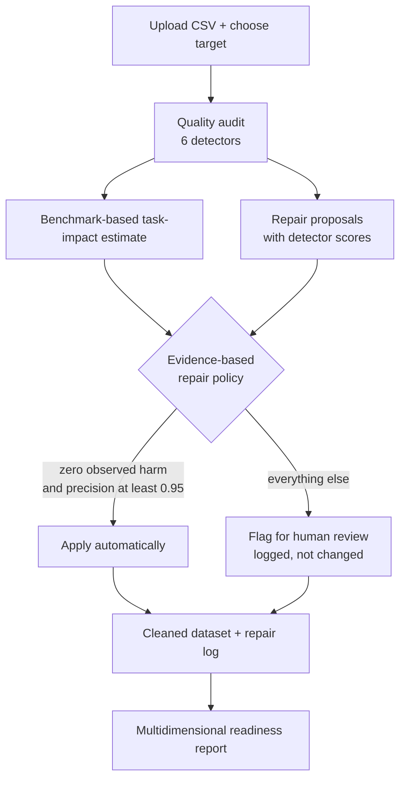
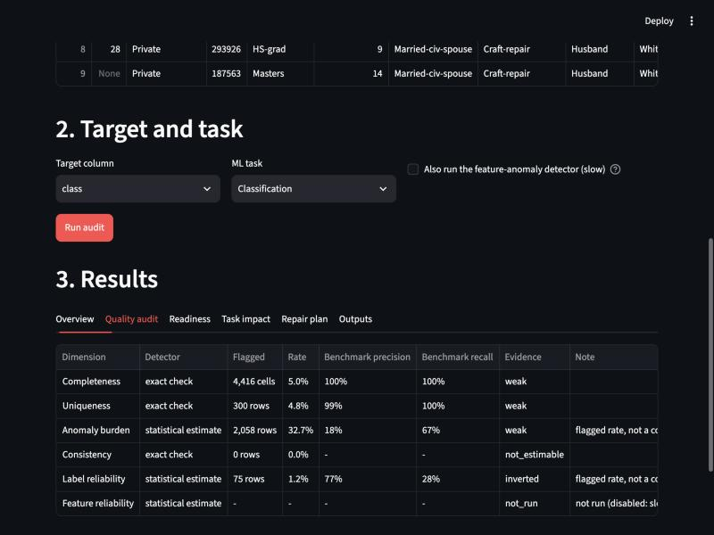
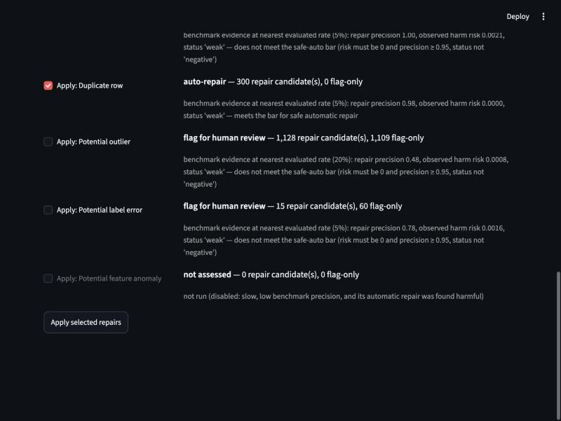
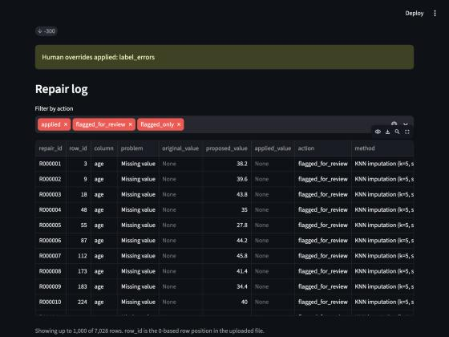
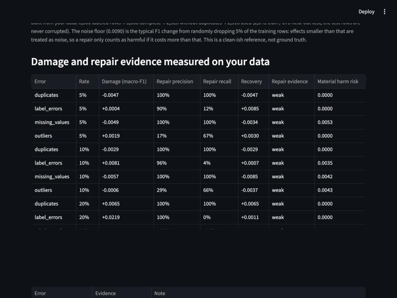

# Task-Aware Data Quality: Impact Analysis and Repair Prioritization for AI-Ready Datasets

**TaskClean** measures how specific data-quality problems actually affect a machine-learning task, decides which
repairs are safe to apply automatically, and reports its confidence honestly, including where a repair makes
things worse.

It is both a **research project** (controlled experiments on UCI Adult, 11 phases) and a **usable tool**
(upload a CSV or Excel file, choose classification or regression, get a cleaned dataset, a full repair log, and a multidimensional readiness report).

> **Research question.** Most cleaning pipelines ask *"is this data wrong?"* TaskClean asks *"is this problem
> actually hurting my ML task, can it be repaired safely, and is it worth the effort?"*

---

## Contents

1. [Key ideas](#key-ideas)
2. [How it works](#how-it-works)
3. [The app](#the-app)
4. [Quick start](#quick-start)
5. [Outputs](#outputs)
6. [How the repair policy decides](#how-the-repair-policy-decides)
7. [Research results](#research-results) (including [the model check, Phase 16](#is-this-about-the-errors-or-about-the-model-phase-16))
8. [Reproducing the experiments](#reproducing-the-experiments)
9. [Project structure](#project-structure)
10. [Limitations](#limitations)
11. [Not done yet](#not-done-yet)

---

## Key ideas

1. **Task-aware impact analysis.** Inject one error type at a time into clean data, retrain, and measure the F1
   loss on an untouched clean test set. Impact is measured, not assumed.
2. **Evidence-based repair, not blanket cleaning.** "Detected" does not mean "safe to repair". A repair is applied
   automatically only if, in the controlled benchmark, it showed zero observed harm and high precision. On the
   Adult evidence it must also pass under a **second model family** (gradient boosting, Phase 16); where the two
   models disagree the stricter verdict is used.
3. **Honest uncertainty.** Every dimension carries an *evidence status* (validated / weak / inverted /
   not estimable) separate from its observed rate. No single readiness score is reported, because the evidence
   did not justify one.
4. **Calibration on your own data.** The Adult results do not automatically transfer. Optionally, TaskClean
   re-runs a small version of the experiments on a clean-ish reference built from *your* data and bases its
   decisions on those measurements instead (see [Calibrating on your data](#calibrating-on-your-data)).

## How it works



The research that backs each box was built phase by phase:

```
Phase 1-2   clean baseline on UCI Adult (70/15/15 split, test set never touched)
Phase 3-4   controlled corruption engine + ground-truth log of every changed cell
Phase 5     blind detectors, graded against that ground truth
Phase 6     quality report (flagged rate kept separate from detector reliability)
Phase 7     per-error impact on F1 (5 error types x 3 rates x 5 seeds)
Phase 8     oracle repair: how much performance is theoretically recoverable
Phase 9     real automated repair, graded on repair correctness AND ML recovery
Phase 10    repair prioritization over impact, repairability and risk
Phase 11    AI-readiness: define, validate against ML impact, build the report
```

## The app

| Quality audit | Repair plan | Repair log |
|---|---|---|
|  |  |  |

Detectors are shown with their benchmark precision/recall; each repair type shows the evidence behind its
auto-repair or review decision; every change (and non-change) lands in the repair log.

## Quick start

Developed and tested on Python 3.14, pandas 3.0, scikit-learn 1.9, Streamlit 1.64.

```bash
python3 -m venv .venv && source .venv/bin/activate
pip install -r requirements.txt

streamlit run app.py
```

Use **"Use demo dataset"** in the app for a one-click run (6,300 Adult rows with all five error types injected).

> If your checkout path contains a space, launch with `.venv/bin/python -m streamlit run app.py`;
> the `streamlit` console script's shebang breaks on spaces.

**React dashboard** (FastAPI backend + React/Vite frontend; the Streamlit app above is unchanged)

```bash
pip install -r requirements.txt                                 # includes the dashboard backend (fastapi, uvicorn)
cd frontend && npm install && npm run build && cd ..            # builds frontend/dist (not committed)
.venv/bin/python -m uvicorn backend.main:app --port 8000        # then open http://localhost:8000
```

For frontend development use `npm run dev` inside `frontend/` (proxies to the backend on port 8000).

**Command line**

```bash
cd src
python3 taskclean.py ../data/demo_dirty_adult.csv --target class --out ../taskclean_output_demo
```

| Flag | Meaning |
|---|---|
| `--target class` | target column. **Omit it for no-target mode**: missing values, duplicates, outliers and inconsistencies only |
| `--feature-anomalies` | also run the slow feature-anomaly detector (its auto-repair is never recommended) |
| `--apply missing_values,label_errors` | explicit human override of the evidence-based policy |
| `--calibrate` | self-benchmark on your own data and base the policy on it (needs a target; about 20 s to a few minutes) |
| `--calibrate-seeds 3` | seeds per measurement (3 = quick, 5 = steadier) |
| `--max-model-rows 30000` | above this many rows the slow detectors run on a stratified sample |
| `--seed 42` | random seed for the model-based detectors |

**Python**

```python
import sys; sys.path.insert(0, "src")
from taskclean import load_csv, audit_dataset, apply_repairs, write_outputs

df, info = load_csv("my_data.csv")              # detects encoding, delimiter and decimal mark
state = audit_dataset(df, target="churned")     # expensive: detect + propose (target=None for no-target mode)
# optional: replace the Adult evidence with measurements from your own data
# from selfbench import run_self_benchmark; from taskclean import attach_self_benchmark
# attach_self_benchmark(state, run_self_benchmark(state, n_seeds=3))
result = apply_repairs(state)                   # cheap: applies what the evidence approves
write_outputs(result, "out/")
```

`audit_dataset` and `apply_repairs` are separate stages so a UI can change the repair plan without paying for the
model-based audit again.

## Outputs

| File | Contents |
|---|---|
| `dataset_cleaned.csv` | **evidence-based file**: only the repairs the benchmark supports (plus any you override) |
| `repair_log.csv` | every proposed, applied, skipped, and flag-only change for that file: row, column, original, proposed and applied value, method, confidence tier, detector score, evidence status, human-override flag |
| `dataset_cleaned_aggressive.csv` | **aggressive file**: every proposed repair except feature-anomaly repairs (missing values imputed, outliers clipped, high-confidence label flips applied). Model-ready, but most of these repairs did not clear the safety bar |
| `repair_log_aggressive.csv` | the same log for the aggressive file |
| `quality_report.csv` | flagged counts and rates per dimension, with each detector's benchmark precision/recall |
| `impact_report.csv` | benchmark-based task-impact estimate, repair evidence, and the decision per issue |
| `readiness_report.json` / `.csv` | the multidimensional readiness report with evidence status, after-cleaning rates, and limitations |
| `selfbenchmark_evidence.csv` / `selfbenchmark_runs.csv` | (only when calibrated) the evidence table and every individual calibration run |
| `baseline_health_report.json` / `.csv` | the **baseline health report** captured when the file was uploaded (see below), as nested JSON and as a flat `section,item,metric,value` table |

### The baseline health report (Phase 18)

Right after upload, before you choose a target or run anything, TaskClean takes a **diagnostic snapshot of the raw file**
and stores it with the dataset. It is shown on the Start page, kept as the **Baseline health** page of the dashboard,
and downloadable (`baseline_health_report.csv` / `.json`). It never changes afterwards: cleaning the data does not touch it,
so it always describes the file as it arrived. It records the file's SHA-256 and capture time.

| Section | What it reports |
|---|---|
| What the file is | file size, SHA-256, rows, columns, memory, how it was read; column type breakdown (numeric, categorical, boolean, datetime, text, numbers stored as text, including currency/percent-formatted numbers such as `"$1,200"`); per column: distinct values, missing, min/median/max or most common values |
| Completeness | missing cells overall and per column (real blanks and placeholders like `?`, `N/A`, `-`), rows with a missing cell, entirely empty columns |
| Duplicates | exact duplicate rows; near-duplicates (equal after trimming, collapsing spaces and lower-casing text) |
| Anomalies | outlier rows by 1.5 x IQR and by \|Z\| > 3; heavily skewed columns (\|skew\| > 1.5); constant columns; possible identifier columns |
| Inconsistent spellings | cells holding a non-canonical spelling of a value (`NYC` / `nyc`), broken down by rule (case/spacing variants: certain; likely abbreviations: verify; ambiguous abbreviations and typos: flagged only), with examples |
| Target (once chosen) | rows without a target, classes and shares, imbalance, classes with fewer than 20 rows |

Each row of the problems table says whether it uses **the audit's own definition** (missing cells, exact duplicates, IQR
outliers, inconsistent spellings: the audit later reports the same numbers, which a test checks) or is **report-only** (near-duplicates,
\|Z\| outliers, skew, constant and identifier columns, formatted numbers: new, not validated, never repaired).
**There is no health score**: the project's own test found an aggregate of detected rates unsupported, and a score would
reward repairs the evidence says can hurt a model. Wrong labels and anomalous feature values need a trained model and stay with
the audit; how much each problem costs a model stays with the Impact page. Spec: [`docs/PHASE18_SPEC.md`](docs/PHASE18_SPEC.md).
Skew is not reported for two-valued (0/1) columns. It was tested on a second real file, IBM Telco churn (`data/telco_churn_original.csv`), which found and fixed three problems, including an abbreviation rule that ran backwards and proposed rewriting `No phone service` to `No` ([Phase 14 Amendment A1](docs/PHASE14_SPEC.md), [Phase 18 notes](docs/PHASE18_SPEC.md)).
One thing it surfaces that the audit does not handle: numbers with currency symbols or thousands separators are read by the audit
as categories, not numbers.

`row_id` in the log is the 0-based row position in the **uploaded** file. A sample set is in
[`taskclean_output_demo/`](taskclean_output_demo/).

The repair log is the product's proof of what it did. [`src/test_taskclean.py`](src/test_taskclean.py) checks, for
**both** cleaned files, that every cell that differs from the uploaded file is a logged, applied repair, that the
log never claims a repair on a row absent from the output, and that the logged value is what the file contains.
It also checks detection against the injected ground truth on the demo, and runs awkward generic CSVs through the
pipeline (IDs, high-cardinality text, booleans, numbers stored as text, placeholders, unlabeled rows).

## Calibrating on your data

The Adult experiments say what hurts and what is safe to repair *on Adult*. With **Calibrate on this dataset**
(`--calibrate`), TaskClean measures it on your data instead:



1. **Reference.** Build a clean-ish subset of your data: complete rows, no duplicates, high-confidence label
   problems removed (columns that are mostly missing or high-cardinality text are left out). It is the best clean
   data that can be derived, not ground truth.
2. **Experiments.** Split it 70/30. For each error type (missing values, duplicates, outliers, label errors) at
   5/10/20% and several seeds, inject *only* that error into the training rows, train a Random Forest, and measure
   the **damage** (macro-F1 and ROC-AUC) against a clean-trained model. Then run the **real TaskClean repair path** on the corrupted
   training data and measure **recovery**, repair precision/recall, and harm. The test rows are never corrupted.
3. **Noise floor.** A null experiment (retrain on a random 90% of the training rows, which should change nothing)
   measures how much each metric moves by chance on *your* data. Effects below it are noise, and a repair only counts
   as harmful if it loses more than that. Small datasets get a larger floor than Adult's 0.003.
4. **Decisions.** The same safe-auto rule runs on your evidence (repair precision of at least 0.95 and no material
   harm on **either** metric). You also get your own damage curves, detector precision/recall, detector false-positive floors, and a
   check of whether each detector's flagged rate tracks real damage on your data.

What it deliberately refuses to do:
- If fewer than 600 clean-ish rows remain, or the target is barely predictable (clean-trained macro-F1 not at least
  0.05 above the same model trained on shuffled labels), it **declines** and the Adult evidence stays in force,
  with the reason reported. "No harm observed" would otherwise be vacuous.
- **Power guard.** If the measurement noise on either metric exceeds 0.01, non-exact repairs (imputation, outlier
  clipping) cannot be certified safe: harm smaller than that would be invisible. A larger clean-ish reference lowers
  the noise; more seeds help only modestly. Exact duplicate removal is exempt.
- **F1 and AUC disagreement is flagged.** On an imbalanced target label noise can *raise* F1 while ROC-AUC falls;
  the report says so instead of reporting "harmless".
- **Exact restoration is never harm.** When a repair reproduces the clean reference exactly (verified by comparing
  the data, as for duplicate removal), a negative recovery means the corruption happened to help by chance, so it
  cannot count against the repair.
- **Label and feature-anomaly repairs are never applied automatically**, whatever the evidence: label repair
  rewrites the target, and the calibration injects *random* errors while real ones are often structured.

On the Adult demo, calibrating on its own 2,916-row reference (about 20 s) reaches the same decisions as the
five-seed, 32,000-row research: duplicate removal is safe; missing-value imputation, outliers and labels go to review.
That calibration is Random Forest only; the Adult evidence it is compared with was additionally re-checked with gradient
boosting (see the model check below).

## Handling real-world CSVs

| Situation | What TaskClean does |
|---|---|
| Unknown encoding / delimiter / decimal mark | detects UTF-8, cp1252 or Latin-1; `,` `;` tab `|`; decimal comma for `;` files |
| Missing values written as `?`, `N/A`, `-`, `null`, empty text | counted as missing in the analysis; the original cell is shown as-is in the log and left unchanged unless a missing-value repair is applied |
| Codes such as `-1`, `-9`, `-99`, `-999`, `-9999` standing for "unknown" (Phase 25) | read as missing when a column has at least 3 of them and every other value is non-negative, in numeric and text columns; never filled in automatically (held back for review; the aggressive file fills them); a code in a regression target makes that row a missing target; a code that fills more than half a column (`pdays = -1`) is kept as a category |
| Words such as `Unknown`, `Unspecified`, `Not available`, `Unknown / Non-Applicable` (Phase 26) | read as missing under the same rules as the codes above (at least 3 cells, at most half the column, never filled automatically); `none` and `other` are real categories and are not touched |
| Values you say mean "missing", such as `0` or `999` (Phase 26) | declared per column on the Start page (a "Placeholders" card), treated as ordinary missing cells for the audit; the same card has a switch to keep a detected column's values as real |
| Numbers stored as text (including `3,5`) | analysed as numeric; imputed values are written back in the same format. Values with leading zeros (ZIP codes) stay text |
| ID columns / high-cardinality text | still checked for missing values and duplicates, skipped by the model-based detectors |
| Rows with no target value | still checked for missing values, duplicates and outliers; excluded from the label and model-based detectors |
| No target column | no-target mode (label check skipped) |
| Very large files | the slow label/feature detectors run on a stratified sample (default limit 30,000 rows); the cheap checks always use every row |
| Continuous or ID-like target | rejected under classification with a message pointing to the regression task (`--task regression`, Phase 21) |

## How the repair policy decides

A repair type is applied **automatically** only if, in the Phase 9 controlled benchmark at the nearest evaluated
corruption rate, all of these hold:

- no seed ever showed net harm (risk = 0),
- repair precision was at least **0.95** (it rarely overwrote legitimate data),
- the repairability status was not *negative*.

On the Random Forest benchmark evidence this was satisfied by exact duplicate removal only. Re-measured with gradient
boosting (Phase 16), duplicate removal did **not** pass the gate at every rate (it failed at 5% and 20%, because with
no training noise the damage it removes is within the corruption-draw noise, so some seeds show a tiny "harm"). The
pre-registered rule therefore applies: on **Adult-sourced evidence nothing is applied automatically**, and duplicate
removal is a *proposal* you can approve in one click. A calibration on your own data (Random Forest, with exact
restoration treated as harmless) can still certify it. Everything is logged as a proposal and flagged for human
review, so `dataset_cleaned.csv` is unchanged by default unless you calibrate or approve a repair. If you need a model-ready
file, `dataset_cleaned_aggressive.csv` applies those proposals too (never feature-anomaly repairs) and its log shows
exactly what changed, so you can judge the risk yourself. You can override per issue type in the app, and
overrides are recorded in the log. The 0.95 threshold is a documented policy parameter in
[`src/taskclean.py`](src/taskclean.py) (`SAFE_REPAIR_MIN_PRECISION`).

**Model check.** Each decision on Adult-sourced evidence carries a *model check* column: `agree` (the Random Forest and
gradient-boosting statuses match), `model-dependent` (they differ, and the stricter status is used), or `not tested`
(dataset-calibrated evidence, and the Phase 14 inconsistency repair, which was not re-measured). There is no model
selector: the product never re-labels Random Forest evidence as gradient-boosting evidence.

*"Repair not recommended" means the evaluated strategy was harmful in testing, not that the underlying error is
inherently unrepairable.*

## Research results

All experiments below use UCI Adult with a Random Forest (300 trees); [Phase 16](#is-this-about-the-errors-or-about-the-model-phase-16) re-checks the key results with gradient boosting. The clean baseline is **F1 = 0.680**
(accuracy 0.851, ROC-AUC 0.903); Logistic Regression reaches F1 = 0.662. Corruption rates are 5/10/20%;
experiments use seeds 42-46 and the train/test split is fixed.

### Impact: how much does each error hurt F1? (Phase 7)

Mean F1 damage vs. the clean baseline, mean ± std over 5 seeds:

| Error type | 5% | 10% | 20% |
|---|---|---|---|
| Label errors | 0.0098 ± 0.0054 | 0.0248 ± 0.0032 | **0.0649 ± 0.0105** |
| Feature corruption | 0.0036 ± 0.0042 | 0.0059 ± 0.0018 | 0.0144 ± 0.0063 |
| Outliers | 0.0028 ± 0.0035 | 0.0051 ± 0.0036 | 0.0091 ± 0.0027 |
| Missing values | 0.0042 ± 0.0051 | 0.0006 ± 0.0046 | 0.0071 ± 0.0032 |
| Duplicates | 0.0005 ± 0.0040 | 0.0020 ± 0.0050 | 0.0020 ± 0.0052 |

Label errors dominate. Duplicates' damage is smaller than its own standard deviation, so it is statistically
indistinguishable from zero. **These are Random Forest numbers.** Re-measured with gradient boosting (Phase 16, below)
label errors are still the largest damage, but about 0.45 times as large (0.030 rather than 0.065 at 20%).

### Detection: can each error be found without ground truth? (Phase 5)

| Error type | Unit | Precision | Recall |
|---|---|---|---|
| Missing values | rows | 1.00 | 1.00 |
| Duplicates | rows | 0.99 | 1.00 |
| Label errors | rows | 0.77 | 0.28 |
| Outliers | cells | 0.18 | 0.67 |
| Feature anomalies | cells | 0.28 | 0.26 |

Grading is cell-level where corruption is cell-level (an earlier row-level grading inflated the feature-anomaly
score from 0.26 to 0.67). Outlier precision is low partly because `capital-gain` is top-coded in the real census data,
so injected extremes are indistinguishable from legitimate ones.

### Repair: does automatic repair help? (Phase 9, mean over 5 seeds)

| Error type | Rate | ML recovery (ΔF1) | Repair precision | Repair recall |
|---|---|---|---|---|
| Duplicates | 10% | +0.0032 | 0.99 | 1.00 |
| Missing values | 10% | -0.0003 | 1.00 | 1.00 |
| Label errors | 10% | +0.0031 | 0.86 | 0.06 |
| Outliers | 10% | +0.0017 | 0.31 | 0.57 |
| **Feature corruption** | 10% | **-0.0071** | 0.33 | 0.12 |

- **Detected is not safe to repair.** Feature-corruption repair is net-harmful at every rate: most of what it
  "fixes" was never corrupted, and the substitutes are worse than the original data.
- **The most damaging error is the hardest to repair automatically.** Label-error repair is precise but its
  recall is 0.01-0.18 under the conservative policy, so it recovers almost none of the damage.
- Missing-value imputation turns net-harmful at 20% (ΔF1 = -0.0054).
- Recovery ratios (recovery ÷ damage) are not reported for duplicates/outliers/missing: numerator and denominator
  are both near the noise floor, so the ratio is unstable.

### Prioritization (Phase 10)

`Priority = w_impact·Impact − w_risk·Risk + w_repair·Repairability`, each min-max normalised within a corruption
rate. Headline at 10% with equal weights: **label errors (0.66) > duplicates (0.35) > outliers (0.31) > missing
values (0.16) > feature corruption (-0.26)**.

Across a grid of 15 weight combinations at 10%, label errors rank first and feature corruption last in **100%** of
them (Random Forest). **Model-dependent ranking:** under gradient boosting the top three are identical and label errors
are first in all 15, but missing values, not feature corruption, ranks last (the KNN-imputation repair hurts gradient
boosting). The two are nearly tied, and the pre-registered check (label first *and* feature corruption last in at least
80% of combinations) failed with 0%. That robustness is **severity-dependent**: at 5% label errors rank first in 53% of combinations, and at 20%
missing-value repair turns harmful and competes with feature corruption for last place.

### AI-readiness (Phase 11)

No single readiness score is reported. Across 15 (error type, rate) points the pooled correlation between
*detected rate* and *measured damage* was **r = -0.24 (p = 0.39)**, and detector baselines sit on incomparable scales.

| Error type | r (detected rate vs. damage) | Reading |
|---|---|---|
| Outliers | 0.99 | tracks damage |
| Feature corruption | 0.95 | tracks damage, high false-positive floor (~46% flagged on clean data) |
| Duplicates | 0.78 | tracks damage |
| Missing values | 0.61 | weak / inconclusive |
| **Label errors** | **-0.95** | **inverted** |

The label-error detector's flagged rate *falls* as true corruption (and real damage) rises, most likely because its
cross-validated model is degraded by the label noise it is auditing. A low flagged label-error rate must therefore
not be read as reassurance. Each correlation rests on 3 rates, so it is directional evidence, not significance.

The product therefore reports a multidimensional readiness table (observed rate, false-positive floor, evidence
status, status, after-cleaning rate) instead of one number. Impact figures are labelled **benchmark-based
task-impact estimates**; for observed rates beyond the validated 0-20% range they are **boundary estimates**.

## Validation on a second dataset

The Adult results were checked on **bank-marketing** (45,211 rows, 11.7% positive class) with an independent
ground truth, and the product was run on Heart Disease and German credit. Full write-up:
[`docs/VALIDATION_SECOND_DATASET.md`](docs/VALIDATION_SECOND_DATASET.md).

- **The product is robust.** It ran on all three datasets with honest repair logs; calibration correctly *declined*
  on Heart Disease (303 rows) and adapted its noise floor on German credit.
- **Detector reliability transfers and calibrates well.** Calibration reproduced each detector's precision/recall within
  about 0.1 (e.g. label errors 0.93 / 0.29 vs ground truth 0.96 / 0.30).
- **The Adult prioritization transfers, but only under a threshold-free metric.** With ROC-AUC, label errors rank first
  in 100% of weight combinations and feature corruption last, exactly as on Adult. With F1 it does not: on this imbalanced
  target label noise *raised* F1 (4 of 5 seeds) while ROC-AUC fell in every seed. **F1-based damage is unreliable on
  imbalanced targets.** (The AUC analysis was added after seeing the F1 anomaly, so it is exploratory.)
- **Calibration did not demonstrably improve the safe-to-repair decisions** (7/9 agreement with ground truth, same as
  the transferred Adult evidence); on a dirty upload it made one false approval, because its noise floor was twice the
  ground truth's. Duplicate removal is the only repair that was safe on both datasets under every metric.
- **Both fixes this exposed are now implemented and re-validated:** the self-benchmark measures ROC-AUC alongside
  macro-F1 (a repair must be safe under both; disagreements are flagged), and non-exact repairs cannot be certified safe
  when the noise floor exceeds 0.01. The false approval is gone, but all evidence sources now tie on this dataset, so
  calibration is still not shown to beat the transferred evidence for that decision (see the follow-up in the report).

## Controlled proof (Phase 20)

The Model panel's held-out rows are as dirty as the file, so a gain there does not show a repair was right. The **Controlled proof**
page (and `src/controlled_proof.py`) starts from clean Adult rows, keeps a **clean** test set, injects five error types (5% each)
into the training rows only, repairs them with the real TaskClean path, and scores four model families on the clean test rows.
Registered 5-seed result (`docs/PHASE20_SPEC.md`, "Results"): **logistic regression improves by +0.015 macro-F1 (5/5 seeds, 44% of the
damage recovered)**, nothing gets worse, but random forest, gradient boosting and the MLP change only within the noise floor. The
pre-registered criterion (improve at least two families) was **not met**; this is reported, not tuned away.

## Regression (Phase 21)

Choose **Regression** on the Start page (or `--task regression` on the command line) when the target is a number. The audit then
checks for **wrong target values** instead of wrong labels (an out-of-fold random-forest regression; a value is flagged when its
residual is more than 4 robust sigmas from the typical residual, scaled within bands of the predicted value). Impact is measured as
**R-squared**, the calibration and the Model panel use regressors (Ridge, random forest, gradient boosting, a small neural net), and no
Adult (classification) evidence is borrowed: without the calibration nothing is repaired automatically.

Controlled proof on California Housing (`docs/PHASE21_SPEC.md`, "Results"; Controlled proof page, Regression tab), 5 seeds, errors injected
into training rows, clean held-out rows: tuned cleaning **improved Ridge (+0.037 R-squared, 25% of the damage) and gradient boosting (+0.016,
33%)**, was within noise for the random forest and the neural net, and made no model worse, so the pre-registered positive criterion
(improve at least two families, worsen none) **passed**. Caveats: the raw-validation variant of tuned cleaning fails the same criterion;
the Ridge result sits at the 80% seed-agreement threshold; outlier capping can be very harmful for regression (it is never chosen by the
tuned selector); and on a clean file the Model panel still reports some improved/worse arms because it measures usefulness to a model,
not correctness of the data (Amendment A2).

## Model panel and file formats (Phase 19, Stage U)

Upload accepts **CSV, Excel (.xlsx/.xlsm), JSON, JSON Lines and Parquet**. An Excel workbook with several sheets reads the first sheet that has data; a sheet picker on the Start page switches sheets without re-uploading (Phase 22). Legacy `.xls` is not supported and says so (save as .xlsx or CSV). Merged cells, formulas that Excel never calculated, and empty rows are reported as notes, not silently changed. After the audit, a background job trains **four model families**
(logistic regression, random forest, gradient boosting, a small neural net) on your raw rows and on the repaired rows (default
file, aggressive file, each repair alone) with the same split and seed, and scores them on the same untouched held-out rows.
Repairs are fitted on the training rows only. Each change is read against a measured noise floor and labelled improved, worse or
within noise (no percentage for the last). It is report-only and shown on the **Model panel** page and the Overview.
Run: `.venv/bin/python src/test_phase19.py`. What it does not show: that a repair was *correct* (the held-out rows are as dirty as
the file), or that the panel tracks a clean-test ground truth (criterion U2, not run). Spec and status: `docs/PHASE19_SPEC.md`.

## Is this about the errors, or about the model? (Phase 16)

Every number above was measured with a Random Forest. Phase 16 re-measured the damage and repair evidence with a
second family, scikit-learn's `HistGradientBoostingClassifier` (changing only the downstream model; the data,
corruptors, preprocessing, detectors and repairs are the frozen code, and the harness reproduces the frozen Random
Forest numbers exactly). The method and ten pass/fail criteria were written before the results:
[`docs/PHASE16_SPEC.md`](docs/PHASE16_SPEC.md) (results and amendments at the end).

**Result: five of ten criteria pass, five fail.**

- **Held up:** label errors are the largest damage under both models and under three model capacities (G2, G8);
  feature-corruption repair is net-harmful under both; the top three priorities are the same.
- **Did not hold up:** the *size* of the damage (median 0.35 times the forest's, G3), the repair verdict for several cells
  (status agreement 11 of 15, the minimum, against 8 for "everything weak"; G4), duplicate removal's automatic approval
  (G5), a missing-values repair that hurts gradient boosting by about 0.02 though not the forest (G6), the bottom of the
  priority ranking (G7), and the Bank Marketing replication on macro-F1 (G9).
- **Bank Marketing:** on macro-F1 the models do not agree (Spearman 0.00, 9 of 15 statuses). On ROC-AUC they agree closely
  (Spearman 0.87, 14 of 15), but that comparison was made after seeing the macro-F1 result, so it is exploratory. There,
  gradient-boosting label-error damage is about *twice* the forest's, the opposite of Adult: the size of the damage
  depends on the dataset and the model together.

What the product does about it (only ever more cautious): impact estimates are labelled with the model and the
gradient-boosting ratio where it is outside 0.5-2.0; Adult-sourced repairs need to pass under both models;
disagreeing cells are marked `model-dependent`; duplicate removal is a proposal on Adult evidence; the priority ranking
carries a model-dependent note. The statement "label errors dominate" stays; the statement about *how much* is
labelled Random Forest.

Limits: two model families, one implementation of each; GB's hyperparameters were fixed from clean Adult data and not
re-tuned for Bank Marketing; Logistic Regression was not part of this phase; the detectors are Random-Forest-based inside, so only the downstream model varied. Two explanations
were not tested: that gradient boosting's smaller Adult damage reflects its higher clean accuracy, and why imputed values
hurt it.

## Why does KNN imputation hurt gradient boosting? (Phase 17)

Phase 16 found that the missing-values repair lowers gradient-boosting F1 by about 0.02 *below* leaving the cells blank
(the shared pipeline already median-fills them). Phase 17 (`docs/PHASE17_SPEC.md`, written before any code) isolates
where. Every arm shares one corruption draw and one KNN run and changes only which blanked cells get KNN values.

| Result (Adult, GB, positive-class F1 vs leaving cells blank) | 10% | 20% |
|---|---|---|
| frozen repair (KNN on all six numeric columns) | -0.0178 | -0.0212 |
| KNN on four columns, median for capital-gain/capital-loss | -0.0032 | +0.0002 |
| KNN on capital-gain/capital-loss only | -0.0180 | -0.0202 |

- **Located:** the harm sits in the two zero-inflated columns. KNN fills those cells exactly right 49% of the time (the
  median: 92%), is twice as far off on average, is biased high, and half its values exist nowhere in the data.
  KNN is a worse point estimate than the median on every numeric column; it matters to the model only in these two.
- **Not caused by:** model capacity (a shallow booster keeps most of the harm, K4 failed) or, mostly, rounding of integer
  columns (K3: small, mixed). The Random Forest is not clearly hurt (within noise).
- **Not shown:** which property of the imputed values makes the booster react; and that it travels: on Bank Marketing the
  harm was below that dataset's noise floor, so the test was **not evaluable**.
- **The fix (shipped).** Numeric columns whose most common value covers at least half the observed cells (here capital-gain
  and capital-loss) are now imputed with the median instead of KNN; other columns still use KNN. This departs from the
  pre-registered rule (which required the Bank test to pass) at the user's request, and is recorded as amendment A3 in
  the spec. Validated on the real product code path: the Adult harm falls from -0.0145 / -0.0195 to -0.0034 / -0.0014
  (10% / 20%; the 10% result clears its 75%-removed bar narrowly, at 76%). On Bank it is neutral within noise. It is
  diagnosed and validated on Adult only.

Run: `.venv/bin/python src/phase17_knn.py --stage a|b|c|d` (about 13, 5, 5 and 11 minutes); tests: `src/test_phase17.py`.

## Reproducing the experiments

Run from `src/`. Adult is fetched via OpenML on first use (copies are in `data/`).

| Phase | Command | Notes |
|---|---|---|
| 2 | `python3 baseline.py` | clean baselines |
| 3-4 | `python3 phase3_4_test.py` | writes `results/corruption_log.csv` |
| 5 | `python3 phase5_test.py` | several minutes (cross-feature detector) |
| 6 | `python3 quality_report.py` | several minutes |
| 7 | `python3 phase7_impact.py --full` | omit `--full` for a quick single-seed run |
| 8 | `python3 phase8_oracle_repair.py --full` | |
| 9 | `python3 phase9_repair_engine.py --full` | long-running (tens of minutes) |
| 10 | `python3 phase10_prioritization.py` | aggregation only, seconds |
| 11 | `python3 phase11_readiness.py` | validation, several minutes |
| 11 | `python3 phase11c_report_demo.py` | renders the readiness report |
| product | `python3 test_taskclean.py` | end-to-end invariants |
| calibration | `python3 test_selfbench.py` | about a minute |
| 13 | `python3 phase13_transfer.py data` then `groundtruth` (about 8 min), `calibration`, `regimes`, `report` | second-dataset validation |
| 16 | `python3 phase16_gb.py --stage N` for N = 0..7 (stage 4 about 90 min, stage 6 about 13 min, stage 7 about 15 min); `python3 test_phase16.py` | gradient-boosting check |
| 17 | `python3 phase17_knn.py --stage a`, `b`, `c`, `d`; `python3 test_phase17.py` | why KNN imputation hurts gradient boosting, and the fix |
| 18 | `python3 test_phase18.py` | baseline health report (a product feature, not an experiment: no results files) |
| 19 | `python3 test_phase19.py` | file intake (CSV/JSON/Parquet) and the four-model panel (Stage U; Stage S not run) |
| 20 | `python3 test_phase20.py` (run: `python3 controlled_proof.py`) | controlled proof on a clean held-out set: tuned-selection leakage, summary logic, saved result endpoint |
| 21 | `python3 test_phase21.py` (run: `python3 controlled_proof_regression.py`) | regression: target handling, wrong-target detector, no silent repair, split integrity, tuned-selection leakage, end to end |
| 22 | `python3 test_phase22.py` | Excel intake: round trip, sheets, layout, robustness, upload equals the same CSV ([spec](docs/PHASE22_SPEC.md)) |
| 23 | `python3 test_phase23.py` (run: `python3 validate_new_datasets.py T`, `A`, `R`, `O`, `C`) | amendment A1 invariants; validation on five genuine files (data in `data/new/`, not committed) |
| 26 | `python3 test_phase26.py` (run: `python3 validate_phase26.py D`, `S0 T`/`A`/`R`/`O`, `S0files`, `S0demo`, `S2`, `B`, `Boff`) | word placeholders, declared values and the keep switch, two report-only diagnostics: planted truth, policy, targets, no change elsewhere ([spec](docs/PHASE26_SPEC.md)) |
| 25 | `python3 test_phase25.py` (run: `python3 validate_sentinels.py D`, `S0 T`/`A`/`R`/`O`/`C`, `S0demo`, `S2`) | placeholder codes read as missing: planted truth, policy, target, no change elsewhere; DS-jobs file in `data/new/` (not committed) |

Every model fit is recorded in [`results/training_log.csv`](results/training_log.csv) (timestamp, duration, model,
hyperparameters, dataset shape, seed). Random Forest has no epochs; the log records fits, not per-epoch loss.
The `*_full.csv` files in `results/` are the authoritative 5-seed results; `*_single_seed.csv` are validation runs.

## Project structure

```
app.py                         Streamlit front end
src/
  taskclean.py                 product layer: audit -> policy -> repair -> reports (also a CLI)
  selfbench.py                 calibration: measures impact, repair effectiveness and harm on the uploaded data
  test_taskclean.py            end-to-end invariants and generic-CSV robustness
  test_selfbench.py            calibration tests (rules match the Adult Phase 10 table; declines when it should)
  data.py  baseline.py         Phase 1-2: data, split, clean baselines
  corruption/                  Phase 3-4: error injection with ground-truth logs
  detect.py                    Phase 5: detectors
  quality_report.py            Phase 6
  phase7_impact.py             Phase 7
  phase8_oracle_repair.py      Phase 8
  phase9_repair_engine.py      Phase 9
  phase10_prioritization.py    Phase 10
  phase11_readiness.py         Phase 11 (+ phase11c_report_demo.py)
  phase13_transfer.py          Phase 13: second-dataset validation (ground truth, calibration check, regime checks)
  training_log.py              provenance log of every model fit
  make_demo_dataset.py         builds data/demo_dirty_adult.csv
  errors.py train.py impact.py repair.py readiness.py pipeline.py
                               superseded v1 prototype (breast-cancer data); not used by the current pipeline
data/                          Adult (original + clean) and the demo dataset with its corruption log
results/                       raw and summary CSVs for every experiment
taskclean_output_demo/         sample outputs of the product on the demo dataset
docs/screenshots/              app screenshots
notebooks/                     syllabus companion notebooks, one per unit (see notebooks/README.md); read-only on src/
```

## Validation on genuine datasets it had never seen (Phase 23)

The tool was run once on Titanic, Ames Housing, a UCI Real Estate `.xlsx`, a 1M-row UCI Online Retail II `.xlsx` and a legacy `.xls`, with
the criteria written first ([docs/PHASE23_SPEC.md](docs/PHASE23_SPEC.md), results in `results/phase23_*.json`). It completed everywhere,
refused the `.xls` with a clear message, read the half-million-row workbook in 11 s, and kept missing-value and duplicate detection exact
(precision and recall 1.00 on injected errors). It also found a real defect: on Ames the calibrated default auto-applied 7,829 imputations,
6,969 of them in columns the calibration never covered (mostly cells where `NA` means "feature absent"). That is fixed (Amendment A1: such
repairs stay in the review queue; 860 are still applied, about 590 of them still structural). The outlier detector is the weakest part:
precision 0.09-0.21 on injected errors and none of 60 sampled real flags was an error, so read outlier flags as "unusual values to
look at". Cleaning did not improve any model on these files.

## Placeholder codes such as -1 (Phase 25)

Using the tool on a scraped job-listings file (`Uncleaned_DS_jobs.csv`) showed that it reported **0 missing cells** on a file that marks "unknown" with `-1`
in nine columns, proposed "clip `Founded` to 1781", and scored models on 50 `-1` ratings. The rule, criteria and results are in
[docs/PHASE25_SPEC.md](docs/PHASE25_SPEC.md) (results in `results/phase25_*.json`): a candidate code (`-1, -9, -99, -999, -9999`) is read as missing when a column has at
least 3 of them, they fill at most half the column, and every other value is non-negative. Measured: planted codes were found with recall and precision 1.00 (36 cases and an Excel
workbook); on the DS-jobs file the audit now finds exactly 372 feature cells and 50 target rows (4.19% of the file, was 0%); the five Phase 23 files, Bank Marketing and the demo
file are unchanged (same counts and decisions; cleaned files byte-identical). Such cells are never filled in automatically, because only you know whether the code is a real value.
Two honest consequences on that file: calibration now declines (544 complete rows, 600 needed; before, it ran on a reference that secretly contained the codes), and the model
score it gave before (Ridge R-squared 0.54) was an artifact of the coded targets (0.03 without them). Cleaning still did not improve any model on it.

## Words, declared values and two diagnostics (Phase 26)

Phase 25 left a list of things it could not handle. Phase 26 ([spec](docs/PHASE26_SPEC.md), results in `results/phase26_*.json`) handles them as far as the evidence allows and says plainly where it does not.
**Words** such as `Unknown` or `Unspecified` (a short list; `none` and `other` are real categories) are read as missing on the same rules as `-1`: at least 3 cells, at most half the column, never filled in automatically.
**`0`, `999` and anything else the tool cannot guess** are declared by you, per column, on the Start page: a scan of every file in the project found real zeros in more than 20 columns and real 999s in three, so no rule could
catch a zero that means "missing" without also flagging correct data. Declared cells are ordinary missing cells; a switch on the same card keeps a detected column's values as real (the way out for a genuine `-1`).
Two **report-only** notes: numeric ranges stored as text (`Salary Estimate`), and a number glued onto a text column that equals another column of the same row (`Company Name` carries `Rating`; with `Rating` as the target that column contains the answer).
Neither is converted: a midpoint would put numbers into a text column or change the model's input without evidence it helps, and rewriting the cell is not something the tool can justify.
Measured: planted words were found with recall and precision 1.00 (63 cases); a declared value matched exactly the planted cells and nothing else changed (9 cases); on the DS-jobs file the audit finds 606 feature cells and 50 target rows (6.51% of the file, was 4.19%),
and on Bank Marketing 15,165 `unknown` cells (the evidence-based file is unchanged, the aggressive file now fills them). Nine files without these patterns give identical results with the feature on and off. Cleaning still did not improve any model on DS jobs.
Not tested: the declared-value path on a real file whose zeros mean "missing" (none was available), Concrete (no `xlrd`), and the hold-back of words on a real file (calibration approved nothing on the files tried).

## Limitations

- **Estimate-based audit.** On an uploaded dataset the true errors are unknown; every rate comes from a detector
  with the precision/recall limits above. A flagged rate is not a confirmed error rate.
- **Benchmark transfer.** Without calibration, impact estimates and repair evidence come from Adult + Random Forest
  and do not transfer automatically to another dataset or model (Phase 16 showed the size of the damage differs
  between a Random Forest and gradient boosting, and that the Bank Marketing comparison did not replicate on macro-F1).
  Calibration measures them on your data, but with a
  Random Forest, macro-F1, a few seeds, and a clean-ish reference rather than true ground truth: undetected problems
  left in the reference and selection bias from dropping incomplete rows can make damage look smaller or repairs
  easier. It injects random errors, so measured repair precision can be optimistic for structured real-world errors.
- **False-positive floors** for the statistical detectors come from clean Adult data unless you calibrate (then they
  come from your reference), so "Attention / Good" is indicative only without calibration.
- **Small validation sample.** Detector-vs-damage correlations use 3 corruption rates per error type.
- **Before/after model metrics for uploads are indicative only.** The Model panel (Phase 19) compares models trained on raw and
  repaired rows, but an uploaded dataset has no clean held-out test set: the held-out rows are as dirty as the file, so a gain
  does not prove a repair correct. Changes below the measured noise floor are labelled as such.
- **Placeholders and blanks that mean "absent".** A token such as `-`, `N/A` or `None` that is a genuine category in your data is over-counted as missing, and a blank that means "no such feature" (Ames: no pool, no garage) looks like a missing value. Imputation of columns the calibration could not cover is held back (Phase 23 A1), but the rest is still imputed under calibration. Only you know which blanks are real. Codes such as `-1` (Phase 25) and a short list of words such as `Unknown` (Phase 26) are read as missing but never filled automatically; a real `-1` or `Unknown` is flagged too, and the Start page has a switch to keep a column's values. `0` and `999` are never guessed: declare them on the Start page. The word list is English only, and declared values apply to the audit, not to the stored Baseline report.
- **Sampling.** On files above the row limit, label/feature findings and proposals cover only the sampled rows.
- **Clustering is not supported.** The tool covers two ML tasks: **classification** and **regression**. Choosing no target audits and cleans
  the file (Quality audit, Baseline, repairs), but it does not rank issues by their impact on a clustering task or compare clustering before and
  after cleaning. This was a deliberate scope decision (2026-11-17): clustering has no ground truth, so a before/after comparison could only
  measure stability, a weaker claim than the other two tasks make. A draft design is kept in `docs/PHASE24_SPEC.md` (deferred, no code written).
- **Scope.** Classification targets (up to 20 classes), regression targets (a number; Phase 21), or no target at all. Duplicates are full-record duplicates (features +
  target). Inconsistent-value repair (Phase 14: case, spacing, punctuation, unique abbreviations) is exact
  (precision 1.0 in validation) but the measured model recovery was negative, so the evidence rule keeps it in the
  review queue; typos are flag-only. The irrelevant-feature check (constant, identifier-like, redundant, or no
  better than 12 random probe columns) is report-only and never edits the cleaned file. The
  feature-anomaly detector is off by default (slow, low precision, harmful repair). See `docs/PHASE14_SPEC.md`.
  **Unusual combinations** (Phase 15: bivariate and multivariate outliers on numeric columns) is an opt-in, flag-only check,
  off by default because its pre-registered validation failed on real data: well calibrated on synthetic data (0.07% of clean
  rows flagged) but 7% of clean Diabetes rows and 30% of clean Breast Cancer rows flagged, and only 10-14% of hidden swaps
  found. Enable it with `--joint-outliers` or the Start-page switch; treat flags as a list to look at, not a rate to trust.
  See `docs/PHASE15_SPEC.md`.
- **No composite score.** The tested aggregate of detected rates was not supported by the evidence; this does not
  prove no composite could ever work.

## Not done yet

- Logistic Regression validation of the Random Forest findings (the Phase 16 harness takes any model, so this needs
  only its own pre-registration).
- Wiring the on-your-data calibration to a second model; *why* gradient boosting reacts to KNN-imputed capital values
  (Phase 17 located it and the product now avoids it; it did not isolate which property of the imputed values the booster
  reacts to, and Bank was too noisy to test whether the finding travels). (The Phase 14 inconsistency result under gradient boosting is measured and shown in the product
  as "model-dependent": injected inconsistencies cost the forest about 0.01 F1 and gradient boosting nothing, status
  `weak` against `negative`, so the repair stays in review.)
- More than one extra dataset; Logistic Regression is likewise untested.
- Calibration of feature-anomaly repair (it stays on the Adult evidence and is never applied automatically).
- Validating calibration against more datasets than Adult and synthetic data.

## Data

UCI Adult (Census Income), loaded through OpenML (`fetch_openml("adult", version=2)`). The demo dataset is a
6,000-row sample with all five error types injected at 5%, generated by `src/make_demo_dataset.py`.
